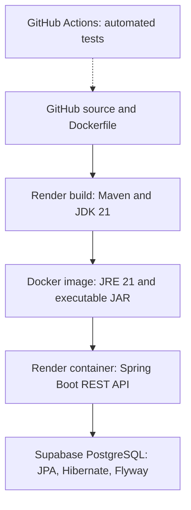

# StockFlow — Backend

Java and Spring Boot REST API for purchase order approval, delivery recording and inventory tracking for small hardware stores.

[Portfolio case study](https://thabo.netlify.app/stockflow.html)

**Live development preview:** [Angular frontend](https://stockflow-management.netlify.app/) · [Backend health](https://stockflow-backend-5cke.onrender.com/actuator/health). Both hosting dashboards confirm deployment; backend health returned `UP` on 26 November 2026. The Netlify same-origin API proxy is configured; proxy CSRF response was verified; full cloud workflows remain unverified.


**Status:** Active development. This is the authentication feature branch; the default-branch baseline is described below. `main` includes purchase order domain rules, typed exceptions and problem-detail mapping, the Product JPA entity and repository, and the Flyway V1 business schema. PostgreSQL connectivity and Actuator health have been verified locally. Business REST endpoints and transactional receipt processing are planned.

## Implementation progress

Local verification on 26 November 2026: 98 backend tests and 66 frontend tests passed (164 combined); both builds succeeded. Authentication and administrator employee management were exercised locally. Supplier API integration tests passed; Angular supplier interface compiled, but dedicated frontend supplier tests and browser acceptance remain pending. Four role accounts were provisioned locally; full role-by-role browser verification and isolated public demo protection remain pending. Cloud preview and API proxy CSRF response were verified earlier; latest feature deployment and full cloud workflows have not been reverified.

Authentication: Argon2id, JWT access tokens, rotating refresh tokens, persisted sessions, CSRF, logout and current-user endpoints. Administrator employee directory supports creation, pagination, role and status changes with session revocation. Supplier directory supports paginated search, creation, updates and soft deactivation; all active roles read, only ADMIN writes.

## System users and responsibilities

StockFlow is an internal procurement system for small hardware stores. It supports multiple employee accounts across four roles, with one role per account initially. Public self-registration is not planned; administrators will provision or invite employees.

| Role | Intended responsibilities |
|---|---|
| Administrator (`ADMIN`) | Manage accounts, roles, suppliers and products; oversee and perform authorized procurement operations. |
| Purchasing Officer (`PURCHASING_OFFICER`) | Create draft purchase orders, submit for approval and cancel eligible orders. |
| Approver (`APPROVER`) | Review and approve orders, and cancel eligible orders. |
| Warehouse Officer (`WAREHOUSE_OFFICER`) | Record partial or complete deliveries and monitor inventory movements. |

All active roles are intended to read orders, products, inventory and stock movements. Business rules apply even to administrators. The workflow is purchasing officer creates order → approver approves → warehouse officer receives goods → inventory is updated. Four role accounts have been provisioned locally; public demo isolation remains pending.

Employee and supplier permissions are implemented on the feature branches; procurement workflow permissions remain planned.

## Cloud deployment and containerization

The authentication feature branch contains a multi-stage Dockerfile. The first stage uses Java 21 JDK and Maven Wrapper to package the Spring Boot executable JAR; the runtime stage uses Java 21 JRE and runs as a non-root user.



**Verification (26 November 2026):** Local Docker startup, Supabase connectivity, all three Flyway migrations and Actuator health passed. Render deployment succeeded and cloud health returned UP. Angular is published on Netlify with a configured same-origin API proxy; the CSRF proxy response was verified; full cloud workflows remain pending.

The cloud profile uses Render's PORT, disables public OpenAPI documentation and exposes the health endpoint at /actuator/health. Configure SPRING_PROFILES_ACTIVE=cloud, STOCKFLOW_DB_URL, STOCKFLOW_DB_USERNAME, STOCKFLOW_DB_PASSWORD and STOCKFLOW_JWT_SECRET_BASE64 in the hosting environment; never commit their secret values. Docker packaging skips tests; GitHub Actions runs verification separately. Local Docker Desktop uses WSL 2 on Windows.

## Technology

| Component | Technology | Status |
|---|---|---|
| Language | Java 21 compilation target | Configured |
| Framework | Spring Boot 4.0.10, Spring Web MVC | Installed |
| Build | Maven Wrapper | Configured |
| Validation | Jakarta Bean Validation | Installed |
| API documentation | SpringDoc OpenAPI 3.0.3 | Installed |
| Monitoring | Spring Boot Actuator | Installed |
| Testing | JUnit, Mockito, MockMvc, Testcontainers, Spring Boot Test | 98 tests passed in the 26 November local Maven build |
| Persistence | Spring Data JPA, Hibernate, PostgreSQL | Product, authentication and supplier mappings on the feature branch |
| Migrations | Flyway | V1–V3 applied and validated |

## Getting started

Use JDK 21 and Git. The Maven wrapper manages Maven.

```powershell
git clone https://github.com/AriesMaster/StockPurchaseOrderBackend.git
cd StockPurchaseOrderBackend
git switch feature/auth-persistence
.\mvnw.cmd clean verify
.\mvnw.cmd spring-boot:run
```

Before starting the application, configure `STOCKFLOW_DB_URL`, `STOCKFLOW_DB_USERNAME` and `STOCKFLOW_DB_PASSWORD` in your local environment. See [database setup and operations](docs/database-operations.md). Feature-branch tests use isolated H2 and Docker-backed PostgreSQL 17 via Testcontainers; start Docker before running them. No Supabase credentials are needed for tests. For feature-branch runtime, also configure STOCKFLOW_JWT_SECRET_BASE64 with a securely generated Base64-encoded key of at least 32 bytes.

On Linux/macOS use `./mvnw` instead of `.\mvnw.cmd`.

| Local endpoint | Purpose |
|---|---|
| http://localhost:8080/actuator/health | Health check |
| http://localhost:8080/swagger-ui/index.html | Swagger UI |
| http://localhost:8080/v3/api-docs | OpenAPI JSON |

Actuator returned `{"groups":["liveness","readiness"],"status":"UP"}` on 24 November 2026. Swagger and OpenAPI browser responses have not been independently verified. Swagger is currently blocked by the feature-branch security configuration; employee and supplier controllers are implemented; procurement controllers remain planned.

## Build and test verification

On 26 November 2026, a local Windows Maven build reported 98 tests passed with zero failures, errors or skips, and reached JAR packaging. Run `.\mvnw.cmd clean verify` from PowerShell to reproduce the build and test run for your checkout.

## Current repository structure

```text
├── .mvn/wrapper/
├── docs/
│   ├── api-contract.md
│   ├── database-design.md
│   ├── physical-dfd.md
│   ├── system-design.md
│   └── technical-specification.md
├── src/
│   ├── main/
│   │   ├── java/com/stockpurchaseorder/backend/
│   │   │   ├── StockPurchaseOrderBackendApplication.java
│   │   │   ├── common/exception/
│   │   │   ├── auth/
│   │   │   ├── product/persistence/
│   │   │   ├── supplier/
│   │   │   └── purchaseorder/domain/
│   │   └── resources/
│   │       ├── application.properties
│   │       └── db/migration/  # V1–V3
│   └── test/
│       ├── java/com/stockpurchaseorder/backend/
│       └── resources/application-test.properties
├── scripts/database/secure_flyway_history.sql
├── pom.xml
├── mvnw
└── mvnw.cmd
```

## Planned architecture and business rules

Angular communicates with Spring MVC controllers over HTTP/JSON. Application services coordinate domain models and transactional persistence through JPA/Hibernate and PostgreSQL.

Orders move from DRAFT to APPROVED, then PARTIALLY_RECEIVED or RECEIVED. Draft or approved orders can be cancelled before receiving stock. A receipt must not exceed outstanding quantities. Receiving 12 of 20 units leaves 8 outstanding; a subsequent receipt of 9 must fail without changing stock.

The receipt, order quantities, inventory balance and stock movements must commit atomically. Idempotency keys prevent duplicate stock updates on retries. Database locking and uniqueness constraints are planned to protect concurrent updates.

## Implemented administration APIs

See [API contract](docs/api-contract.md) for employee and supplier endpoints.

## Planned procurement API

| Method | Path |
|---|---|
| POST | /api/purchase-orders |
| GET | /api/purchase-orders/{id} |
| POST | /api/purchase-orders/{id}/approval |
| POST | /api/purchase-orders/{id}/cancellation |
| POST | /api/purchase-orders/{id}/receipts |
| GET | /api/inventory/{sku} |
| GET | /api/stock-movements |

See the API contract for payloads, error codes and replay semantics.

## Roadmap

- [x] Spring Boot scaffold, Maven build and starter context test
- [x] Domain models and JUnit business-rule tests
- [x] Typed domain exceptions and problem-detail mapping
- [x] PostgreSQL connection, Flyway V1, connection pool and local health verification
- [x] Database RLS and history table hardening on the development database
- [x] Product JPA entity and repository
- [x] Authentication design
- [x] User schema, credential verification and session services on `feature/auth-persistence`
- [x] Login, refresh, CSRF and current-user HTTP endpoints on the authentication branch
- [x] Verify logout on the authentication branch
- [x] Provision four role accounts and verify local administrator sign-in
- [x] Employee management API and UI
- [x] Supplier migration, API and backend tests
- [x] Supplier Angular interface and production build
- [ ] Supplier browser acceptance and frontend feature tests
- [ ] Remaining JPA entities and repositories
- [ ] Transactional receipt processing and idempotency
- [ ] Business REST controllers and HTTP contract tests
- [x] Authentication integration and refresh concurrency tests on the feature branch
- [ ] Business integration and concurrency tests
- [x] Angular authentication and employee integration
- [ ] Remaining procurement Angular integration
- [x] Automated Java CI on `feature/auth-persistence`
- [x] Local Docker runtime and Render image build on the authentication branch
- [x] Verify cloud startup and health; deploy Angular frontend
- [x] Verify deployed CSRF proxy response
- [ ] Verify latest deployed browser workflows and demo isolation

Authentication and permission rules are described in the [security design](docs/security-design.md). Do not commit database credentials or other secrets.

## Documentation

- [Security design](docs/security-design.md)
- [System design](docs/system-design.md)
- [Technical specification](docs/technical-specification.md)
- [API contract](docs/api-contract.md)
- [Database design and ERD](docs/database-design.md)
- [Database setup and operations](docs/database-operations.md)
- [Physical DFD](docs/physical-dfd.md)
- [Angular frontend](https://github.com/AriesMaster/StockPurchaseOrderFrontend)

See [LICENSE](LICENSE).
