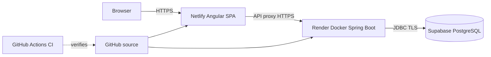

# Cloud deployment and operations

This guide describes StockFlow on [`feature/auth-persistence`](https://github.com/AriesMaster/StockPurchaseOrderBackend/blob/feature/auth-persistence/docs/cloud-deployment.md). For the original `main` code and design, see the [baseline version](https://github.com/AriesMaster/StockPurchaseOrderBackend/blob/46754bb0c9ab96d6708aa9bb2e3341d6729a8c17/docs/cloud-deployment.md).

**Status:** Netlify published the Angular development preview from feature/auth-ui; Render deployed feature/auth-persistence, and its public Actuator health endpoint returned UP on 26 November 2026. The Netlify CSRF proxy response was also verified. The 27 November test and build results cover the latest supplier catalogues and draft orders locally. A hosted browser walkthrough remains pending.

- Frontend: https://stockflow-management.netlify.app/
- Backend health: https://stockflow-backend-5cke.onrender.com/actuator/health

## Build and runtime

Netlify uses Node 26.13.0, npm run build and dist/stock-purchase-order-frontend/browser. The feature branch netlify.toml routes /api/* to Render before the SPA fallback. Render builds a multi-stage Docker image with Maven and Java 21 JDK, then runs the executable JAR on Java 21 JRE as a non-root user. The cloud profile uses Render's PORT, disables public OpenAPI documentation and exposes Actuator health. Local Docker Desktop uses WSL 2.

## Configuration

Render requires SPRING_PROFILES_ACTIVE=cloud, STOCKFLOW_DB_URL, STOCKFLOW_DB_USERNAME, STOCKFLOW_DB_PASSWORD and STOCKFLOW_JWT_SECRET_BASE64. Keep values secret; no database or signing secrets are required on Netlify. Flyway manages schema migrations. Do not modify applied migrations.

## Verification and limitations

- Local backend verification on 27 November: Maven clean verify passed 122 tests and packaged the JAR.
- Local frontend verification on 27 November: Angular production build succeeded and 123 Vitest tests passed.
- Development PostgreSQL: Flyway V1–V6 validated locally.
- Cloud health and Netlify CSRF proxy: verified on 26 November.
- Pending: deploy and verify the latest supplier catalogue/product/order workflows, then exercise cloud login and role permissions in a browser.
- Isolated accounts for public demo access are planned.
- Free Render instances may sleep and introduce cold-start delays.
- GitHub Actions verifies builds/tests separately from Docker packaging; check the current run before promoting changes.
