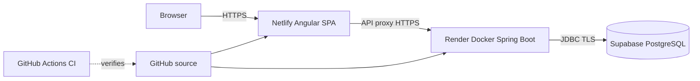

# Cloud deployment and operations

**Status (26 November 2026):** Netlify published the Angular preview from feature/auth-ui; Render deployed feature/auth-persistence and the public Actuator health endpoint returned UP. Browser API proxy, authentication and business workflows are not yet verified.

- Frontend: https://stockflow-management.netlify.app/
- Backend health: https://stockflow-backend-5cke.onrender.com/actuator/health

## Build and runtime

Netlify uses Node 26.13.0, npm run build and dist/stock-purchase-order-frontend/browser. The feature branch netlify.toml routes /api/* to Render before the SPA fallback. Render builds a multi-stage Docker image with Maven and Java 21 JDK, then runs the executable JAR on Java 21 JRE as a non-root user. The cloud profile uses PORT and exposes Actuator health while disabling public OpenAPI. Local Docker Desktop uses WSL 2.

## Configuration

Render requires SPRING_PROFILES_ACTIVE=cloud, STOCKFLOW_DB_URL, STOCKFLOW_DB_USERNAME, STOCKFLOW_DB_PASSWORD and STOCKFLOW_JWT_SECRET_BASE64. Keep values secret; no database or signing secrets are required on Netlify. Flyway manages schema migrations. Do not modify applied migrations.

## Verification and limitations

- Local verification: 62 backend tests and 30 frontend tests passed.
- Cloud backend health: UP.
- Netlify publish: confirmed by hosting dashboard.
- Pending: verify /api/auth/csrf through Netlify (204 and expected cookie), browser login, refresh, logout and role permissions.
- Free Render instances may sleep and introduce cold-start delays.
- GitHub Actions verifies builds and tests separately from Docker packaging. Verify current CI status before promoting changes. Do not treat the preview as production-ready.
