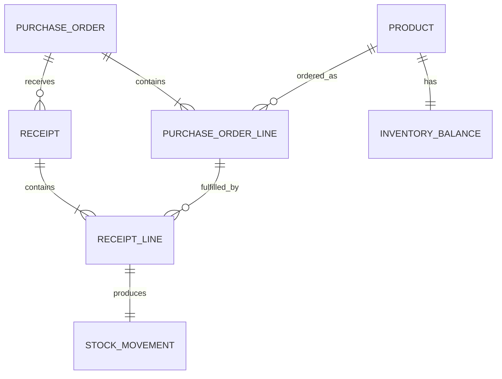
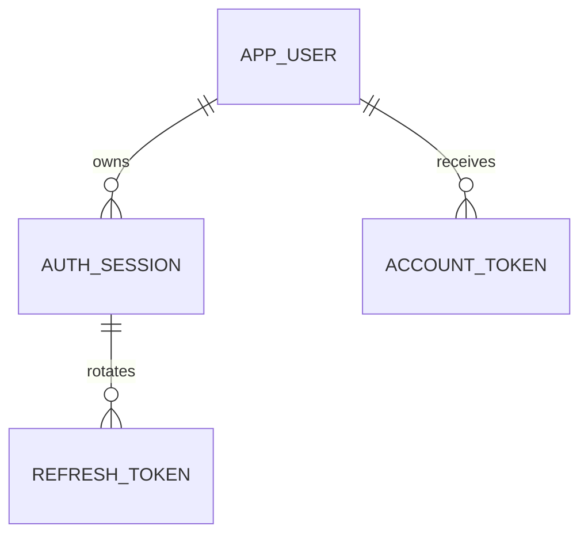

# Database design

**Status.** Implemented initial PostgreSQL schema for the first release. The system tracks whole-unit quantities at one stock location.

## Entity relationship diagram

A purchase order line can be fulfilled by several deliveries. Every receipt line produces one stock movement. The product for a movement is identified through its receipt line.

## Tables and keys

| Table | Primary key | Other columns and constraints |
|---|---|---|
| `product` | `sku` | `name` |
| `purchase_order` | `id` | `status`, `created_at`. Status is one of `DRAFT`, `APPROVED`, `PARTIALLY_RECEIVED`, `RECEIVED`, or `CANCELLED`. |
| `purchase_order_line` | `(purchase_order_id, sku)` | Both key columns are foreign keys. `ordered_quantity > 0` and `0 <= received_quantity <= ordered_quantity`. |
| `receipt` | `id` | `purchase_order_id` references the order. Store `idempotency_key`, `request_fingerprint`, `recorded_at`, and `order_status_after`. Enforce uniqueness on `(purchase_order_id, idempotency_key)` and on `(id, purchase_order_id)` for the composite foreign key below. |
| `receipt_line` | `(receipt_id, sku)` | `(receipt_id, purchase_order_id)` references the receipt. `(purchase_order_id, sku)` references the order line. This keeps every line on the same order as its receipt. Store `quantity > 0` and `outstanding_quantity_after >= 0`. |
| `inventory_balance` | `sku` | SKU references the product. `quantity_on_hand >= 0`. Create the balance with the product and initialise it to zero. |
| `stock_movement` | `id` | `(receipt_id, sku)` is a unique foreign key to the receipt line, so a line can generate only one movement. Store `quantity_change > 0` and `recorded_at`. |

The receipt service creates the receipt lines and their stock movements in the same transaction. The unique movement key enforces at most one movement per receipt line. The service ensures at least one line per order and receipt and exactly one movement per line.

Use `bigint` identity columns for generated IDs, `integer` for quantities, `timestamptz` for timestamps, and `text` for SKUs and idempotency keys. Require values for all listed columns.

## Implementation status

Flyway `V1__initial_schema.sql` creates the seven application tables, constraints and indexes, enables RLS and revokes direct privileges from `anon`, `authenticated` and `PUBLIC`. V1 is applied and validated on the development Supabase database. Flyway's separate history table is hardened through the manual administration script. See [database operations](database-operations.md). Product JPA mapping and repository are implemented and startup validation succeeded. Remaining mappings and database integration tests are pending.

## Example

An approved order contains 20 units of `PAINT-20L`. A delivery of 12 creates a receipt line for 12, leaves 8 outstanding on the order line, adds 12 to the inventory balance, and appends a stock movement of +12. The API can replay that receipt after later deliveries by using the stored order status and outstanding quantity from the original transaction.

[Technical specification](technical-specification.md) · [API contract](api-contract.md)

## Planned authentication ERD

See [security design](security-design.md) for fields and constraints. These tables are not yet migrated.
