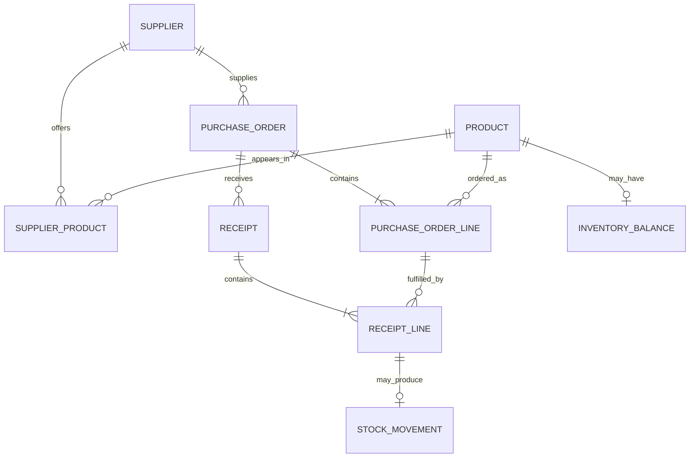

# Database design

This guide describes StockFlow on [`feature/auth-persistence`](https://github.com/AriesMaster/StockPurchaseOrderBackend/blob/feature/auth-persistence/docs/database-design.md). For the original `main` code and design, see the [baseline version](https://github.com/AriesMaster/StockPurchaseOrderBackend/blob/46754bb0c9ab96d6708aa9bb2e3341d6729a8c17/docs/database-design.md).

## Applied schema migrations

Flyway V1–V6 define the current development schema. The migrations have been applied and validated against the development PostgreSQL database.

| Version | Schema change |
|---|---|
| V1 | Initial product, purchase-order, receipt and inventory schema. |
| V2 | app_user, auth_session, refresh_token and account_token authentication tables, role checks, RLS and revoked direct Supabase client grants. |
| V3 | Supplier table. |
| V4 | Product base price, active flag and optimistic-lock version. |
| V5 | Supplier reference on purchase orders and product-name/unit-price snapshots on order lines. |
| V6 | Supplier-to-product catalogue with supplier-specific unit price and active flag. |

Applied migration files are immutable; future schema changes need a new Flyway migration.

## Entity relationship diagram

The product and supplier tables are current master data. supplier_product connects a supplier to each product it offers and stores that supplier's current price. Order lines keep name/price snapshots so a later catalogue edit does not rewrite historical orders. Receipt and inventory tables are defined in the initial schema, but receipt/inventory application workflows are not implemented yet.

## Current tables

| Table | Key | Current fields and constraints |
|---|---|---|
| product | sku | Name, base unit_price, active, optimistic-lock version. SKU is the stable stock-keeping identifier. |
| supplier | id | Name, optional contact name/email/phone/address, active flag and timestamps. |
| supplier_product | id; unique (supplier_id, sku) | Foreign keys to supplier and product, supplier unit_price >= 0, active flag. |
| purchase_order | id | Supplier FK, status and created timestamp. |
| purchase_order_line | (purchase_order_id, sku) | Ordered/received quantities, product-name and supplier-price snapshots; positive ordered quantity and nonnegative outstanding quantity. |
| receipt | id | References a purchase order and stores the idempotency key, request fingerprint, receipt time and status after receipt. `(purchase_order_id, idempotency_key)` is unique. |
| receipt_line | (receipt_id, sku) | Foreign keys link the receipt and order line on the same order. Stores positive received quantity and the outstanding quantity after receipt. |
| inventory_balance | sku | References the product. `quantity_on_hand` must be non-negative. |
| stock_movement | id | Stores a positive quantity change and timestamp. The unique `(receipt_id, sku)` key allows at most one movement per receipt line. |
| app_user, auth_session, refresh_token, account_token | See V2 | Persistent account, role, session and token records. Invitation/reset token schema exists; those endpoints are not currently exposed. |

The schema enables row-level security on application tables and revokes direct access from Supabase anon, authenticated and PUBLIC roles. Application authorization is still enforced by Spring Security.

## Purchase-order price snapshot example

If Supplier A offers SCREW-BOX for R12.50 and the order requests 20 boxes, the API stores the supplier, product name, quantity and R12.50 unit-price snapshot. The line total is R250.00. Updating Supplier A's catalogue later does not change this draft's saved price. The same SKU can have a different unit price in Supplier B's catalogue.

## Current persistence status

JPA/Hibernate mappings and repositories support users/sessions, products, suppliers, supplier offers and purchase orders. Flyway creates the receipt and inventory tables, but corresponding receipt/inventory application services, endpoints and stock updates remain future work.

The planned receiving service will create exactly one stock movement per receipt line in the same transaction. The existing database constraint enforces the upper bound.

See [database operations](database-operations.md), [technical specification](technical-specification.md) and [API contract](api-contract.md).
