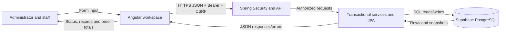
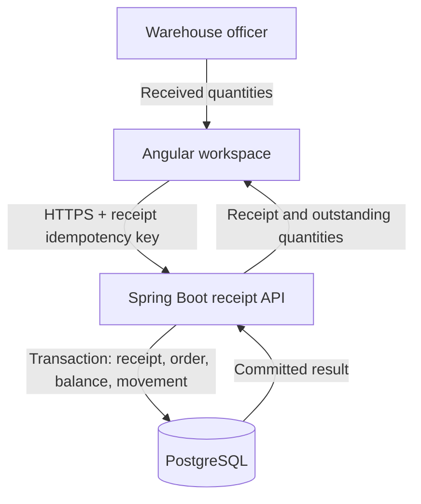

# Physical data flow diagram

## Implemented flows

Current flows include authentication/session management, employee administration, supplier and product maintenance, supplier-specific product offers, and draft purchase-order creation/list/detail.

- ADMIN manages employees, suppliers, products and supplier offers.
- All active roles can read suppliers, products, offers and purchase orders.
- ADMIN and PURCHASING_OFFICER can create purchase orders.
- A new draft references one supplier and saves product names and prices from that supplier's active catalogue.

## Draft-order data flow

1. An administrator sets up products and assigns them to supplier catalogues with current unit prices.
2. A purchasing user chooses one supplier, then adds one or more active products from that supplier's catalogue with quantities.
3. Angular requests CSRF then posts the draft to POST /api/purchase-orders.
4. Spring Security validates token/session, role and CSRF. The service validates supplier/product/offer state, snapshots product names and prices, and commits the draft through JPA.
5. The API returns JSON with supplier name, order status, line quantities, unit prices, line totals and order total. Angular displays the draft in the order directory and details view.

## Future receipt and inventory data flow

Approval, receiving and inventory updates are not yet implemented. The intended future path is:

A receipt should update order quantities, inventory balances and stock movements atomically. Retries should return the original receipt without counting stock twice. These are future design requirements.

## Cloud topology

Browser → Netlify Angular SPA → HTTPS API proxy → Render Docker Spring Boot → JDBC/TLS → Supabase PostgreSQL.

Backend health and the Netlify CSRF response were verified on 26 November 2026. On 27 November both local builds passed. A hosted browser walkthrough of the latest catalogue and draft-order flow remains pending.

[System design](system-design.md) · [API contract](api-contract.md)
