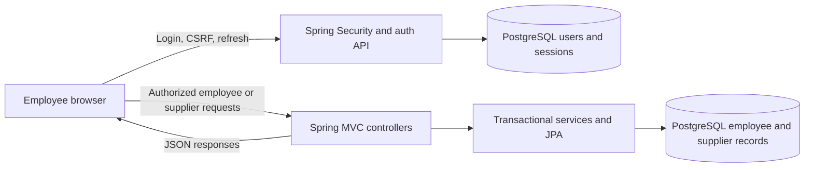
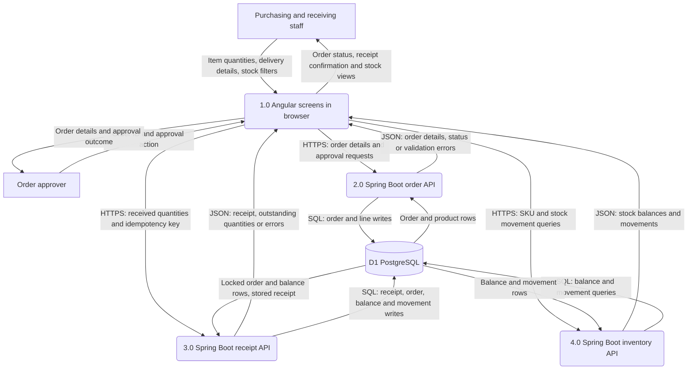

# Physical data flow diagram

## Implemented administration data flows

Employee administration is ADMIN-only. Supplier reads are available to all active roles; writes are ADMIN-only. The supplier UI compiles but browser acceptance is pending. The original procurement DFD below remains a target.

**Original design baseline.** See the implementation checkpoint above for current feature-branch status.

## Implementation notes

- The three Spring Boot processes represent responsibilities inside one application. Spring Data JPA and Hibernate handle database access.
- A receipt and its inventory changes commit together. A valid retry returns the stored receipt without creating another movement.
- PostgreSQL is the persistent data store. Its tables and keys are defined in the [database design and ERD](database-design.md).
- Staff and approver labels describe who handles each workflow step. Authentication and cloud topology are defined; the business flows above remain target flows.

[System design](system-design.md) · [API contract](api-contract.md)

## Cloud topology (deployed preview)

Browser → Netlify Angular SPA → HTTPS API proxy → Render Docker Spring Boot → JDBC/TLS → Supabase PostgreSQL. Both hosting deployments are published and backend health is verified. Proxy and end-to-end business/authentication flows remain unverified. See [cloud deployment and operations](cloud-deployment.md).
