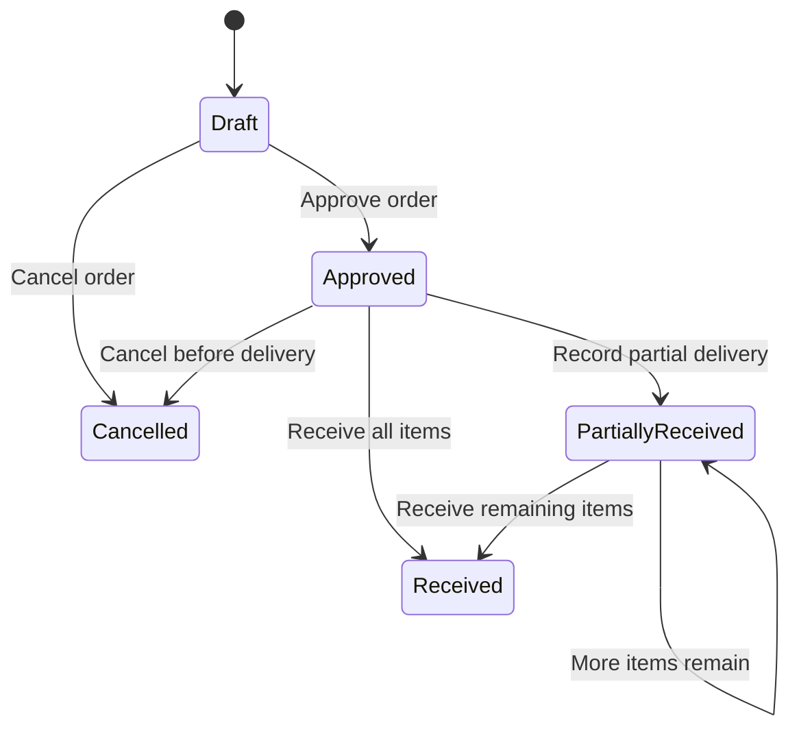

# Stock and Purchase Order System Design

**Status.** First-release design. The Angular public homepage, Java purchase order domain, exception mapping and PostgreSQL schema are implemented. Backend startup and health are verified; business screens, endpoints and JPA persistence remain planned.

## Purpose and scope

Give a small business a record of what it ordered, what arrived, what is still outstanding, and how each delivery changed stock. The first release covers purchase order approval, partial and full receipts, stock balances, and stock movement history for a single location. Staff create orders and receive deliveries. An approver authorises orders before deliveries can be recorded. These are workflow roles. Authentication and permissions follow the security design. Authentication foundations exist on feature branches.

## Architecture

| Component | Responsibility |
|---|---|
| Angular frontend | Create orders, show approval and delivery status, submit receipts, and display stock balances and movement history. |
| Spring Boot API | Accept HTTP requests and return JSON. Apply order and receipt rules in the Java domain model and coordinate database writes in application services. |
| Spring Data JPA and Hibernate | Map persisted Java data to PostgreSQL and load it for the application services. |
| PostgreSQL | Store products, purchase orders, receipts, inventory balances, and movement history. Enforce data integrity through keys and constraints. |

## From purchase order to inventory

1. Staff create a draft order with a SKU and ordered quantity for each item. An approver approves the order before stock can be received.
2. Staff record a delivery in Angular. Angular sends the received quantities and an idempotency key to the Spring Boot API. It reuses that key when retrying the same submission.
3. The receipt service checks the order status and outstanding quantities. It saves the receipt, updates the order and inventory, and appends a stock movement for each receipt line in one PostgreSQL transaction.
4. The API returns the receipt and updated order status as JSON. Angular displays the recorded quantities and any amount still outstanding.

## Example and failure behaviour

| Scenario | Expected result |
|---|---|
| An approved order is for 20 units and 12 arrive | The order becomes partially received. Eight units remain outstanding, inventory increases by 12, and the movement history shows +12. |
| The same receipt is retried with the original key and quantities | The API returns the original receipt. Inventory and movement history stay the same. |
| Another delivery attempts to add 9 units when 8 remain | The API rejects the delivery. The order, inventory, and movement history stay the same. |
| A database write fails while recording a delivery | The transaction rolls back so the receipt, order status, stock balance, and movement history stay consistent. |

## Implementation and verification

1. Completed: Java 21-targeted starter, domain tests, PostgreSQL connection, Flyway V1 and local health check.
2. Next: JPA entities, repositories and PostgreSQL integration tests.
3. Implement transactional services and REST endpoints; verify retries, concurrency and rollback.
4. Connect Angular screens, verify the end-to-end example and configure CI/CD.

## Detailed designs

- [Physical data flow diagram](physical-dfd.md) for browser, API, and database exchanges.
- [Backend technical specification](technical-specification.md) for Java responsibilities, business rules, and receipt transaction behaviour.
- [Spring Boot API contract](api-contract.md) for endpoints, JSON payloads, and error responses.
- [Database design and ERD](database-design.md) for PostgreSQL tables, relationships, and constraints.
- [Angular frontend repository](https://github.com/AriesMaster/stock-purchase-order-frontend) for the user interface.

## Authentication extension (in development)

Angular authenticates through Spring Security before accessing business endpoints. Four roles separate purchasing, approval, warehouse and administration. See [security design](security-design.md) for the authoritative permission and session model; this supersedes earlier open authentication decisions.

## Cloud topology (deployed preview)

Browser → Netlify Angular SPA → HTTPS API proxy → Render Docker Spring Boot → JDBC/TLS → Supabase PostgreSQL. Both hosting deployments are published and backend health is verified. Proxy and end-to-end business/authentication flows remain unverified. See [cloud deployment and operations](cloud-deployment.md).
